# Tinhead's Combat HUD

This is a nested radial Combat HUD for **Foundry VTT v14** and **dnd5e 6.0.0+**. dnd5e 6.0.0 and requires Foundry 14.367 or later. It lets players or the DM view all actor or NPC actions, reactions, bonus actions, and skill checks in an easy-to-view way, without opening the character sheet every time.  Clicking a function on the Combat Hud, hands off any rolls to either Midi-QOL or the inbuilt functions of Foundry.

It is not accessible when the game is paused.

When installed, it places a target icon with a sword on the bottom left when you right-click the targeting icon to the lower right of the character icon

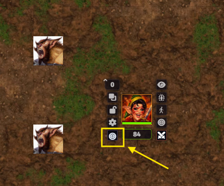
  
Clicking the icon opens the basic combat HUD, which you can drag around by holding the left mouse button on the **End Turn** button and moving it to a more appropriate spot on your screen; it will remember this location the next time you open it.  A small window also starts in the top right of the screen, letting you toggle whether the HUD stays open all the time or closes after any function is activated.  This can also be dragged to a more appropriate position..

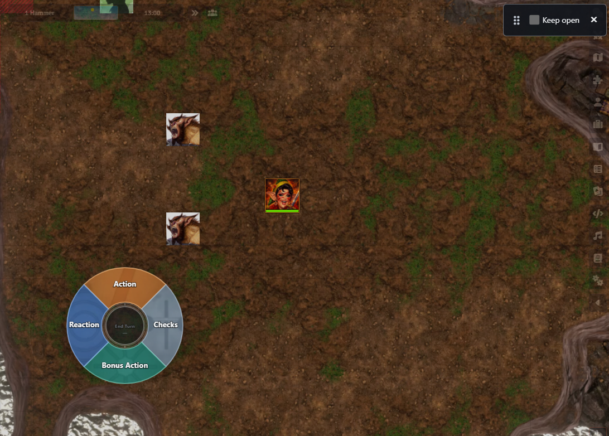

All images the HUD uses are taken from the source, whether that is the compendium or world items.

## Using the HUD 

Once the HUD is open and on the screen, moving over any of the wedges will show different functions that can be carried out as either an **Action**, **Bonus Action**, **Reaction** or **Checks**.  These are reliant on the relevant functions being set up correctly on the character sheet as it filters them by their action types.

### Actions 

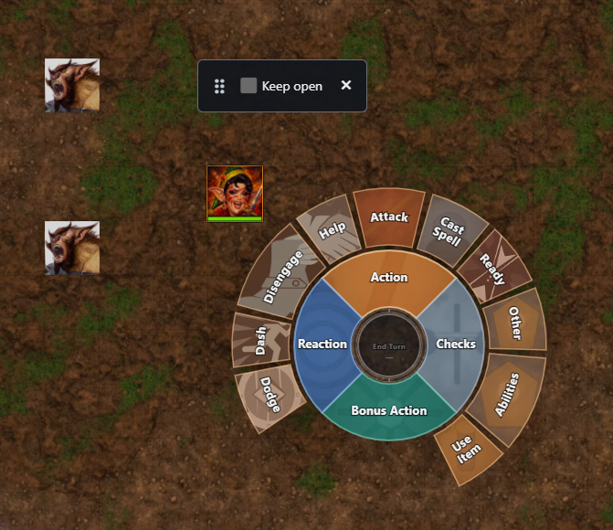

Under the Action wedge you will find all things that can be carried out as an action.  

These include **Attack**, **Cast Spell, **Use items**, **Dodge**, **Disengage** etc.  Moving over the relevant wedge may open up a further radial depending on whether there are a choice of options available within that action.  For example, **Attack** should show any equipped weapons, allowing you to attack with them; **Cast Spells** will show the spell levels and number of spell slots (if any available to you), moving onto a spell level opens up available spells in that level.  Hovering over the spell will provide a tool tip for that spell.

Weapons that are not equipped do not show on the Hud.

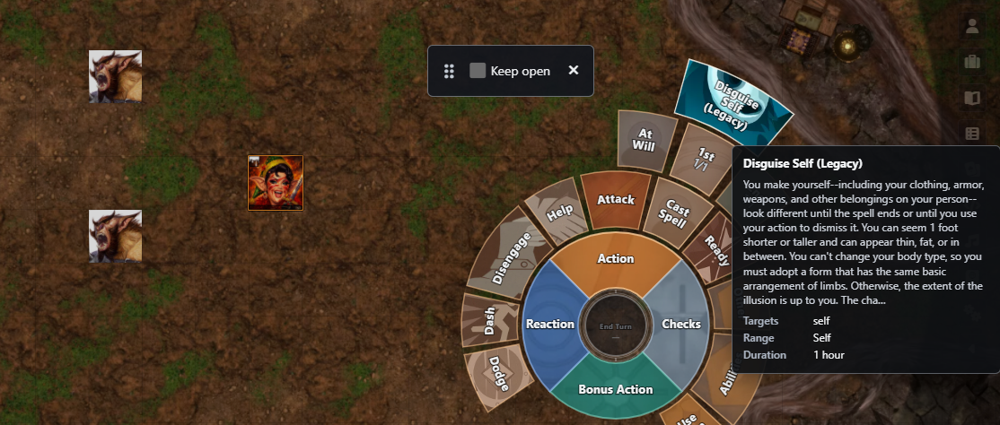

Clicking the action will offload it to Foundry or Midi-Qol to complete the task and generate any rolls.

**Abilities** shows items that you may be able to do as part of your class, such as channel divinity, Lay on Hands or Recover Sorcery Points.  Again these rely on them being set up correctly on the character sheet.

If you have no abilities under this tab, a message pops up saying 'No Feature Options".

**Ready** allows you to prepare an action for use later in the turn.  

Selecting the action you wish to take will generate a window for you to enter the trigger.  Once entered, click the hold action button where a chat card to notify the DM what your action and trigger are.  

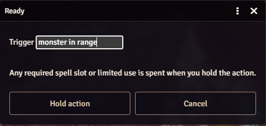
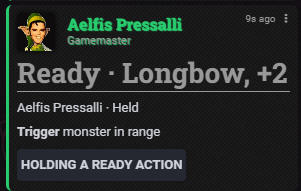

A window will then pop up for the player who can complete the action when the trigger for their action occurs.  Should the combat tracker move to a new round then the ready action will expire and any resources will be consumed.

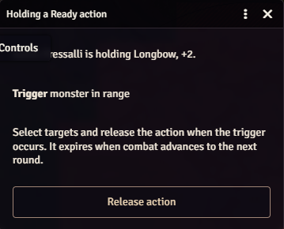

The attack will then complete when the actor's trigger takes effect. It is also completes at the start of the characters next turn if it has not already completed and any resource is consumed.

**Use item**

This opens a new radial where items stored in your inventory can be used.  Where there are multiple types of an item (for example different potions) these are collated together allowing a further radial to populate with them; another example would be a character holding lots of scrolls.

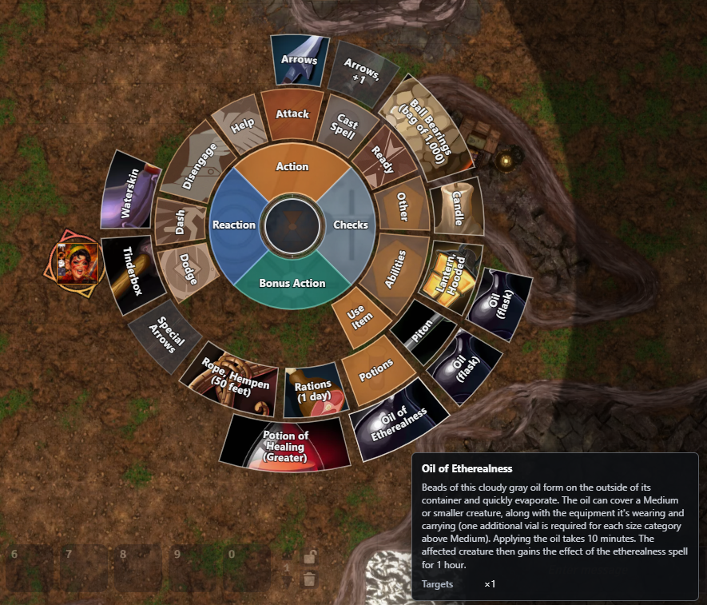

## Bonus Action 

This lists those abilities that can be carried out as a bonus action and can include **Use Item** such as taking a potion during combat (if allowed) or *Cast Spell** such as **Misty Step**

## Checks

Under the skills wedge you will find the characters **skills**, **saving throws** and **Death Saves**.  All use the characters ability modifiers from their character sheet and clicking the wedge triggers the appropriate roll mechanism, depending on which you are using. 

**Skills** are colour coded based on their base attribute and those with a silver border indicate skills that have proficiency; those with a gold border have expertise applied to them.  Tool tips show the applied base attribute and their modifier and whether they have proficiency or expertise; another example would be a character holding lots of scrolls.

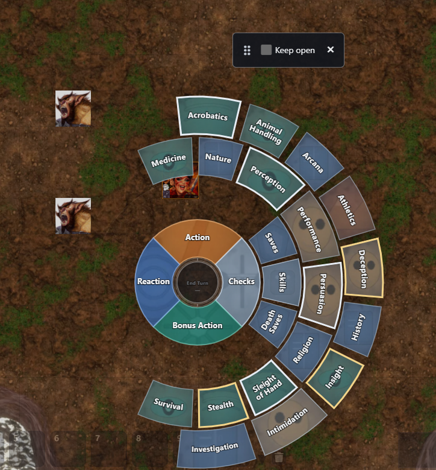

**Death Saves** checks to ensure a character has 0 hp and throws up a message if that's not the case.  Clicking the wedge rolls a D20 marking a success or failure on the character sheet.  The tool tip for this shows the current state of any successes or failures.

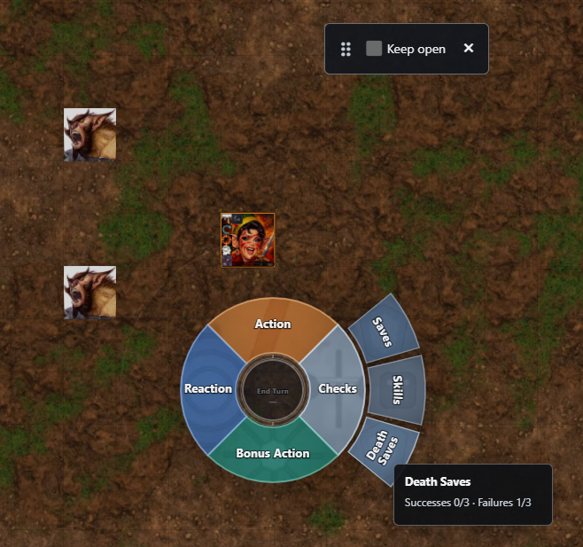

## Reaction

Under this wedge are any abilities that are allowed as a reaction, whether they are spells, attacks of opportunity or other.  

**Attack of Opportunity** mirrors your equipped weapons and if you have the **War Caster* feat, your spells are also listed under here.
**Uncanny Dodge is listed under here for rogues.

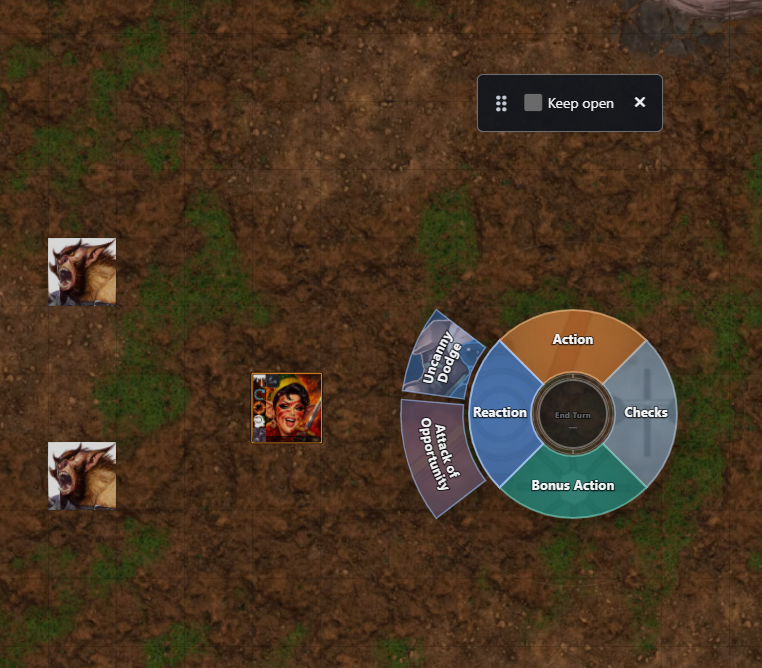

## End Turn

In the centre of the Hud is the End Turn button.  This only works if you are the active character in the combat tracker.

## Settings

The individual colours of the hud can be amended within the game settings menu.  These are retained between game sessions.

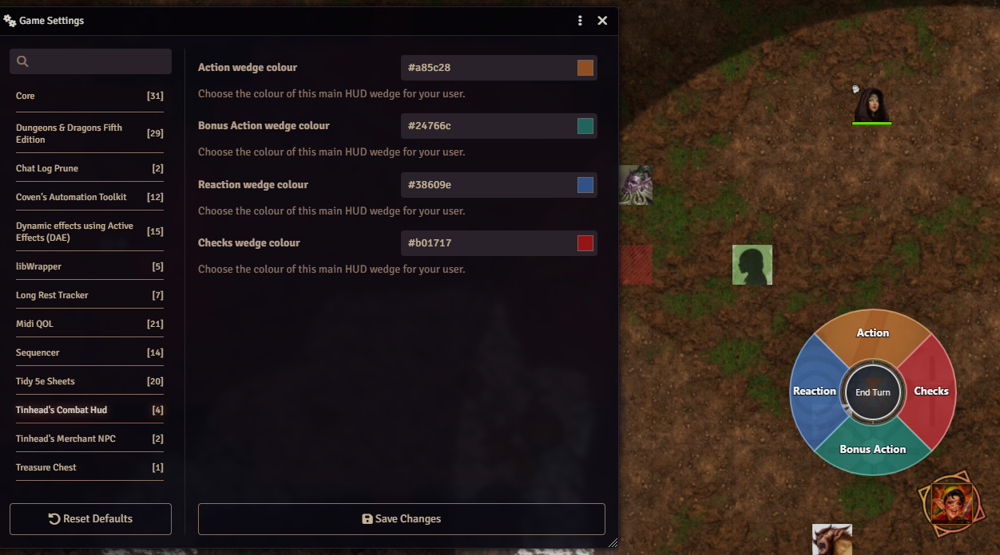

## Supported version 

This project supports **Foundry VTT v14 only**, with a minimum version of **14.367** and **dnd5e 6.0.0**.

